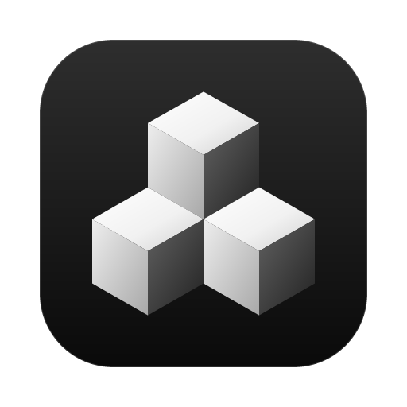

<p align="center">
  
</p>

<h1 align="center">Kubach</h1>

<p align="center">
  <b>原生、GPU 加速的 Kubernetes IDE——并为你的 AI 代理开一扇安全的门。</b>
</p>

<p align="center">
  <a href="https://github.com/BigTows/kubach/releases"></a>
  
  
  
  <a href="LICENSE"></a>
</p>

<p align="center">
  <a href="README.md">English</a> · <a href="README_RU.md">Русский</a> · <b>简体中文</b>
</p>

---

> [!NOTE]
> **Kubach 是一个 vibe-coded 项目。** 几乎所有代码都由 AI 代理编写，由人来把握方向、
> 审查结果并做出决定。我们提前说明这一点，让你清楚自己运行的是什么。

## 为什么选择 Kubach

- **原生、快速。** 使用 Rust 和 [GPUI](https://gpui.rs) 编写——GPUI 是 Zed 编辑器背后的
  GPU 界面框架。内部没有 Electron，也没有浏览器。
- **不往集群里装任何东西。** Kubach 在你的电脑上运行，使用你的 kubeconfig 中的权限：
  没有集群内代理，没有 Operator，也没有 CRD。
- **为与 AI 协作而生。** Kubach 同时也是 MCP 服务器。Claude Code、Claude Desktop 或任何
  其他 MCP 客户端都可以在你设定的范围内操作集群，代理永远看不到你的凭据。
- **kubeconfig 安全无忧。** 导入的配置保存在加密保险库中，可用密码、**Touch ID** 或
  **Windows Hello** 解锁，并随屏幕一起锁定。

## 功能

**探索**
- 同时连接多个集群：瞬间切换上下文，连接保持就绪。
- 支持所有资源类型（包括 CRD），通过 list + watch 实时更新，附带事件和诊断。
- **拓扑**：从 Ingress / Gateway API 到 Service、工作负载和 Pod，再到 ConfigMap、
  Secret 和 PVC 的关系图。标出失效的引用，并检查 NetworkPolicy
  （"A 能否通过 443 端口访问 B？"）。
- 基于 Prometheus 的流量图层，支持 Istio、Linkerd 和 Cilium Hubble。
- 来自 metrics-server 的 CPU 和内存用量，以及来自 Prometheus 的历史数据。

**运维**
- 日志、exec、port-forward、调试容器以及节点 shell。
- Scale、rollout restart、cordon / drain 和驱逐（eviction）。
- 带语法高亮的 YAML 编辑器，应用前查看 diff，支持 server-side apply。
- Secret 始终保密：只有点击"显示"时才获取值，从不缓存，复制到剪贴板后会定时清除。
- 内置终端，其 `KUBECONFIG` 仅限当前上下文。

**交付**
- **Helm**：release、历史、upgrade、rollback，带图标和 README 的 Chart 仓库，以及 OCI
  Chart。Kubach 可以为你下载固定版本、经过校验和验证的 `helm`。
- **Kustomize**：在应用之前构建 overlay 并查看 diff。
- **GitOps**：显示管理某个资源的 Argo CD Application 或 Flux Kustomization / HelmRelease。

**与 AI 协作**（[MCP](docs/guide.md#mcp-ии-агенты)）
- 会话限定在一个上下文、若干命名空间和一个权限配置之内：`read-only`、`debug` 或 `deploy`。
- 权限按需授予：代理提出请求，你在 Kubach 窗口中选择同意或拒绝。
- 修改、exec 以及每次查看 Secret 都需要你确认，也可以限制为仅 dry run 和 diff。
- 每次调用都会记入审计日志，日志中不含 Secret 的值。
- 供代理使用的拓扑工具：`get_topology` 和 `can_reach`。
- 通过 stdio（`kubach mcp`）或 `127.0.0.1` 上带 bearer 令牌的 HTTP 连接。

**宾至如归**
- Kubach Dark 和 Kubach Light 两套主题。
- 界面支持英语、俄语和简体中文。

## 安装

从 **[Releases](https://github.com/BigTows/kubach/releases)** 下载最新版本。
每个版本都提供 x64 和 arm64 两种架构。

| 系统 | 安装包 | 说明 |
|---|---|---|
| **macOS** 11+ | `Kubach-<version>-macos-<arch>.dmg` | 已使用 Developer ID 签名并经过公证 |
| **Windows** 10+ | `.msi` 安装程序或便携版 `.zip` | 正在通过 SignPath Foundation 申请代码签名：在此之前 SmartScreen 可能会发出警告 |
| **Debian / Ubuntu** | `.deb` | `sudo apt install ./kubach_*.deb` |
| **Fedora / RHEL / openSUSE** | `.rpm` | `sudo dnf install ./kubach-*.rpm` |
| **Arch Linux** | `.pkg.tar.zst` 或 `PKGBUILD`（`kubach-bin`） | `sudo pacman -U kubach-*.pkg.tar.zst` |
| **任意 Linux** | `.AppImage` 或 `.tar.gz` | 需要 glibc 2.35+ 和 Vulkan 驱动 |

**代码签名：**由 [SignPath.io](https://about.signpath.io) 免费提供代码签名，
证书由 [SignPath Foundation](https://signpath.org) 颁发。

每次推送到 `main` 都会生成最新构建，可在
[Actions 产物](https://github.com/BigTows/kubach/actions/workflows/build.yml)中下载。

### 连接你的 AI 代理

首先在 **设置 → 安全** 中为某个上下文开启代理访问。该功能默认关闭。

Kubach 可以自动把自己注册到你的代理中。它会先展示配置文件和改动，在你确认后写入，
同时保留你的其他服务器，并备份原文件：

```sh
kubach mcp install claude-code      # 还支持：codex、opencode、cursor、claude-desktop
kubach mcp clients                  # 查看已连接的代理
kubach mcp uninstall cursor
```

你也可以自己运行 stdio 服务器并调整会话：

```sh
kubach mcp                                   # 由代理选择上下文，Kubach 会先征求你的同意
kubach mcp --context prod --namespace shop   # 固定上下文和命名空间（-n 可重复）
kubach mcp -c staging -p read-only --ttl 2h  # 限制权限配置和会话时长
kubach mcp -c dev -n web --grant-read        # 预先允许读取：无需运行应用也能读取
kubach mcp --help
```

| 参数 | 含义 |
|---|---|
| `-c, --context NAME` | kubeconfig 上下文（不带任何参数时由代理选择、你来确认） |
| `-n, --namespace NS` | 将会话限定在某个命名空间；可重复指定多个 |
| `-p, --profile` | `read-only`、`debug` 或 `deploy`：会话可请求的最高权限 |
| `--ttl` | 会话时长：`30m`、`2h`、`1h30m`（默认 30 分钟） |
| `--grant-read` | 无需询问即允许读取会话的命名空间；Secret 和修改仍需确认 |

权限请求和修改需在 Kubach 窗口中确认，因此请保持应用运行，并开启
**设置 → AI 代理 → HTTP 服务器**。同一个 HTTP 服务器也可以直接为代理提供服务，地址为
`http://127.0.0.1:<port>/mcp`，使用 bearer 令牌。包含你的路径、端口和令牌的现成命令位于
**设置 → AI 代理 → 连接代理**。

可执行文件位置：macOS 为 `/Applications/Kubach.app/Contents/MacOS/kubach`，
Linux 安装包为 `/usr/bin/kubach`，Windows 为 `C:\Program Files\Kubach\kubach.exe`。

## 从源码构建

需要较新的 stable Rust 工具链，以及 GPUI 在各平台的依赖：macOS 上的 Xcode，Windows 上的
Visual Studio C++ 生成工具，Linux 上的 X11/Wayland、xkbcommon、Vulkan 和 fontconfig 开发包。

```sh
cargo run --release                        # 应用
cargo run -p kubach-ui --example gallery   # 设计系统组件库
```

[指南](docs/guide.md)介绍了各平台细节、kubeconfig 保险库、MCP 配置和打包（目前仅有俄语版）。

## 了解更多

- [指南](docs/guide.md)：构建、kubeconfig 保险库、MCP 配置。
- [架构](docs/architecture.md)和[架构决策记录](docs/adr/README.md)。
- [项目规则](AGENT.md)：代理遵循的约定。

版本号格式为 `YEAR.MONTH.INC`，例如 `2026.10.1`。

## 许可证

[MIT](LICENSE)
