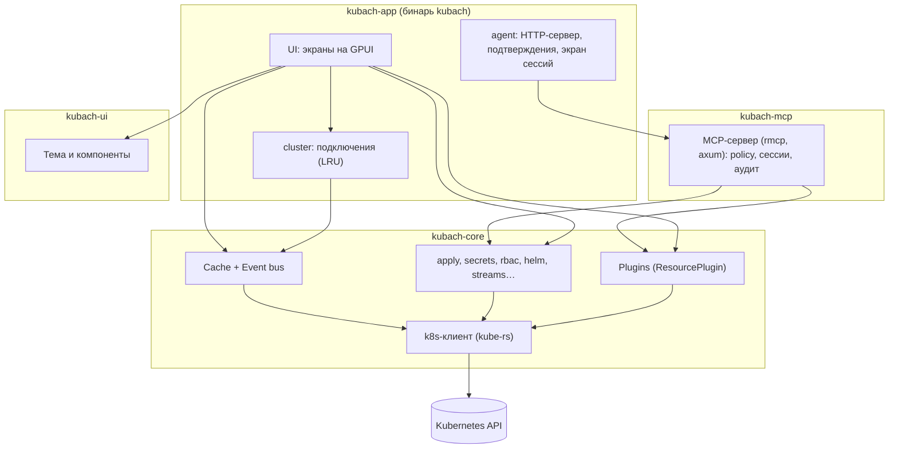
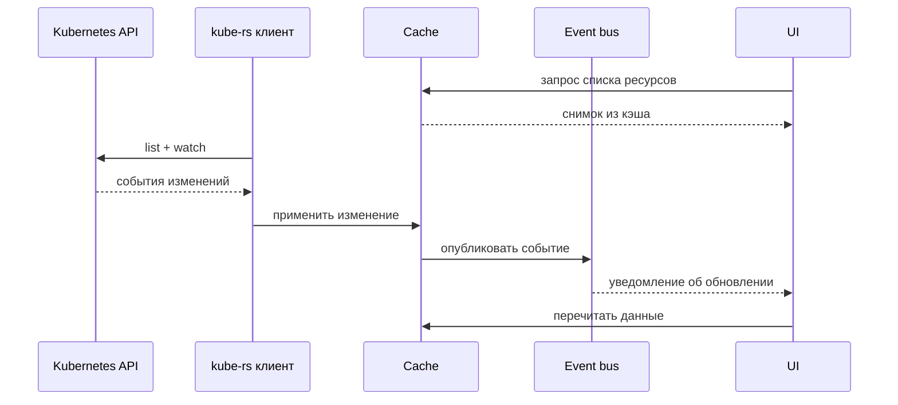
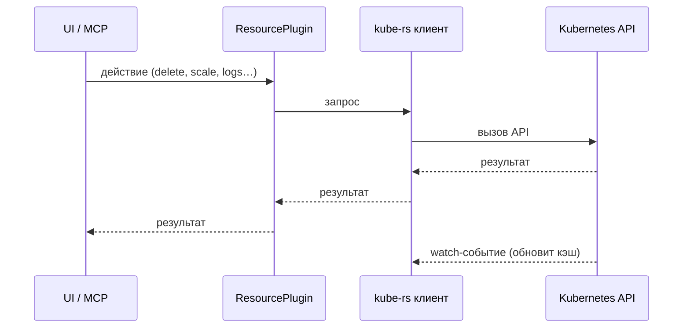

# Архитектура Kubach

Kubach — десктопная Kubernetes IDE. Всё работает локально на машине пользователя;
в кластер ничего не устанавливается (см. [ADR 0004](adr/0004-local-only.md)).

## Слои

Зависимости крейтов: `kubach-app → kubach-mcp → kubach-core`, `kubach-app → kubach-core`,
`kubach-app → kubach-ui`. `kubach-core` и `kubach-ui` друг от друга не зависят,
`kubach-mcp` не знает про GPUI и `kubach-ui`. Переводы интерфейса — крейт `kubach-i18n`
(Fluent, без GPUI, [ADR 0018](adr/0018-i18n.md)): от него зависят `kubach-app`,
`kubach-ui` (встроенные тексты компонентов) и `kubach-core` (только ради `Message` — текста,
который переводит UI).

MCP кэш приложения не использует: у каждой MCP-сессии свой `kube::Client` под
идентичностью сессии (пользователь из kubeconfig или временный ServiceAccount, см.
`kubach_mcp::identity` и `kubach_mcp::session`), и инструменты (`kubach-mcp/src/tools.rs`)
читают и меняют кластер прямыми запросами к API через этот клиент.

| Слой | Где | Ответственность |
|------|-----|-----------------|
| core | `kubach-core` | Клиент k8s на `kube-rs`, kubeconfig, контексты, зашифрованное хранилище импортированных kubeconfig (`kubach-core::vault`, [ADR 0008](adr/0008-kubeconfig-vault.md)), доменные типы. Без UI-зависимостей |
| kubeconfig review | `kubach-core::kubeconfig::review` | Что kubeconfig делает на компьютере, кроме запросов к API: запускаемые программы (exec-плагины, `cmd-path` провайдера `gcp`) с окружением и читаемые локальные файлы — показывается пользователю при импорте |
| redact | `kubach-core::redact` | Убирает креды из текстов ошибок (например, вывод упавшего exec-плагина в `AuthExecRun`); `redact::client` строит клиент с такими ошибками. `mask_text`/`mask_secrets` — единственная маскировка токенов в тексте, ею же MCP маскирует логи, вывод exec и аудит |
| runtime | `kubach-core::runtime` | Общий tokio-рантайм (2 потока) для I/O: `spawn` возвращает `BackgroundTask` — задача отменяется, когда владелец (экран, вкладка, entity) отпускает handle; `spawn_detached` — только для работы, которая должна пережить владельца; `blocking` — CPU-работа вне I/O-потоков ([ADR 0011](adr/0011-async-runtime.md)) |
| process | `kubach-core::process` | Запуск внешних программ (`helm`, `kustomize`, `kubectl`) в одном месте: таймаут, `kill_on_drop`, обработка stdout/stderr ([ADR 0006](adr/0006-helm.md), [ADR 0007](adr/0007-kustomize.md)) |
| pty | `kubach-core::pty`, `kubach-core::kubeconfig::temp` | Локальная оболочка в PTY/ConPTY для вкладки «Terminal» и временный kubeconfig (`0600`) с одним текущим контекстом для её `KUBECONFIG` ([ADR 0015](adr/0015-local-terminal-kubeconfig.md)) |
| connections | `kubach-app::cluster` | Несколько одновременных подключений, см. [ниже](#несколько-подключений) |
| settings / state | `kubach-core::settings`, `kubach-core::state` (#153) | В папке настроек (`KUBACH_CONFIG_DIR` или папка ОС): `settings.toml` правит пользователь (`kubach-core::settings`, схема с версией и миграциями, отслеживание изменений); `state.json` Kubach ведёт сам — то, что запоминается между запусками (сейчас выбор namespace и recent по контексту). Состояние одноразовое: битый файл или запись дают значения по умолчанию, запись атомарная, через 500 мс после изменения и при выходе (`kubach-app::state`). Namespace при открытии контекста: запомненный выбор → `clusters.default_namespaces` → namespace из kubeconfig → All |
| cache / event bus | `kubach-core::cache` | Локальный кэш ресурсов, наполняемый через list+watch (ленивые подписки, дебаунс уведомлений, Secrets без значений); шина событий об изменениях |
| topology | `kubach-core::topology` | Граф связей приложения: Ingress/Gateway API → Service → workload/Pod → ConfigMap/Secret/PVC/ServiceAccount и внешние адреса, типизированные рёбра со стабильными id, диагностика висящих ссылок; строится из снимков `ResourceCache` (`TopologySource`) ([ADR 0016](adr/0016-topology.md)); слой трафика из Prometheus — встроенные плагины Istio/Linkerd/Cilium Hubble (`topology::traffic`, [ADR 0017](adr/0017-traffic-layer.md)) |
| secrets | `kubach-core::secrets` | Значения Secrets только для человека в UI: отдельный GET в момент «Показать», точечный merge patch изменённых ключей, создание; значения не попадают в кэш, логи и `Debug`. MCP значения читает своими запросами в `kubach_mcp::secret_tools` (#227): метаданные и проверки без значений, раскрытие только с подтверждением пользователя для конкретного Secret; пишет Secrets через пользователя в `kubach_mcp::secret_write` (#230): значения вводятся или генерируются (`secrets::generate`) в форме приложения (`kubach-app::agent::secret_dialog`) и агенту не возвращаются; из `kubach-core::secrets` берёт лишь проверки (`checks`, `refs`, `typed`). Что считается Secret и как прячутся значения, решает один модуль `secrets::mask` (#205): предикаты `is_core_secret(group, kind)` (тип ресурса) и `is_secret_value` (манифест, только по `kind`), `redact` для кэша (значения `data` → `null`, `stringData` и аннотация `last-applied-configuration` удаляются) и `mask_for_diff(before, after)` для диффов Kustomize и ревью редактора (значения `data`/`stringData` → `hidden-<фингерпринт>` по ключу, случайному на каждый запуск: одинаковые совпадают, изменённые различаются; `last-applied-configuration` удаляется). Кэш, браузер, редактор, Kustomize, MCP (`masking`, `policy`) своих проверок не держат; у MCP свой плейсхолдер с размером. Настройка контекста «Скрывать значения Secrets» (`ContextPolicy::allows_secret`, по умолчанию вкл.) запрещает показ, копирование, загрузку значения и reveal в Helm/Kustomize; замена «вслепую» остаётся |
| tools | `kubach-core::tools`, `kubach-app::tools` (#131) | Загрузка внешних инструментов по явному запросу (сейчас `helm`): закреплённая версия, проверка SHA-256, установка в папку данных Kubach без записи в систему; общий `ToolSpec` для следующих инструментов ([ADR 0006](adr/0006-helm.md)) |
| images | `kubach-core::images`, `kubach-app::images` (#167) | Иконки чартов и картинки README по URL из чартов: ленивая загрузка видимого, ограничение параллельности, размера и времени, дисковый кэш `<config dir>/cache/images`. Всё, что можно скачать или пересобрать заново, кладётся в `<config dir>/cache` (`kubach-core::disk_cache`): Settings → General → Storage → «Clear cache» удаляет папку целиком; настройка «Load chart icons» выключает все такие запросы ([ADR 0006](adr/0006-helm.md)) |
| metrics | `kubach-core::metrics`, `kubach-core::metrics::prometheus` | Текущее потребление из metrics-server; история из Prometheus ([ADR 0009](adr/0009-prometheus-metrics.md)). `prometheus::source` — какой Prometheus использует контекст (выбор в настройках против запомненного поиска в `state.json`); `prometheus::usage` — колонки CPU и памяти в таблицах из Prometheus, когда metrics-server нет (#179) |
| secret clipboard | `kubach-core::secrets::clipboard`, `kubach-app::secret_clipboard` (#203) | Скопированное значение Secret очищается из буфера через `CLIPBOARD_TTL`, а также при блокировке хранилища и выходе; запись в буфер с пометками ОС (`secret_clipboard::platform`): concealed/transient на macOS, исключение из истории на Windows, `x-kde-passwordManagerHint: secret` на Linux через `arboard` (X11 и Wayland data-control; без дисплея — обычная запись GPUI). Так же копируется MCP-токен |
| plugins | `kubach-core` | Встроенные реализации `ResourcePlugin`: как получать, показывать и действовать над типом ресурса ([ADR 0003](adr/0003-in-tree-plugins.md)) |
| UI | `kubach-app`, `kubach-ui` | GPUI-экраны; дизайн-система (тема, компоненты) живёт в `kubach-ui` |
| MCP | `kubach-mcp`, `kubach-app::agent` (#12, #86) | Доступ ИИ-агентов к кластеру: policy, сессии, аудит в `kubach-mcp`; в приложении — HTTP-сервер на `127.0.0.1` с bearer-токеном (у моста для `kubach mcp` свой токен, #191), подтверждения в главном окне, экран сессий и аудита в Settings → AI agent; `kubach mcp` — тот же бинарь в stdio-режиме без окна; сессии на контекстах из хранилища ведёт приложение (`kubach_mcp::hosted`/`proxy`, #121). Механизм прав — [ADR 0005](adr/0005-mcp-permissions.md) |

Прочие модули `kubach-core`: `apply` (разбор, схема, diff и SSA — [ADR 0010](adr/0010-apply.md)),
`discovery`, `events`, `diagnostics`, `security`, `rbac`, `streams` (логи, exec, port-forward,
debug-контейнеры, shell на ноде), `eviction` и `drain` (Eviction API, `kubectl drain`), `helm`,
`kustomize`, `gitops`, `probe`, `shell_env`.

## Несколько подключений

`kubach-app::cluster::Cluster` держит подключённым не только активный контекст:
каждая сессия (`Session`) — это своё подключение (`Connection`), discovery и
`ResourceCache`. Недавно использованные контексты хранятся в `RecentContexts`
(самый свежий первым); при переключении `Cluster::touch` поднимает контекст наверх,
а вытесненные сверх лимита отключаются, и их кэш освобождается. Лимит —
`clusters.keep_connected` в `settings.toml` (`kubach_core::settings::Clusters::keep_connected`, по умолчанию
`DEFAULT_KEEP_CONNECTED` = 3, минимум 1 — активный контекст); изменение настройки
применяется без перезапуска. Возврат к контексту из списка мгновенный: кэш и watch
уже работают. `Cluster::disconnect` закрывает подключение вручную.

Список контекстов (kubeconfig из `KUBECONFIG` / `~/.kube/config`, файлы из
`clusters.kubeconfig_paths` и импортированные в vault) загружает и отслеживает только
`Cluster`: один набор `notify`-watcher на файлы, чтение и слияние — в фоне
(`background_spawn`), чтобы не блокировать UI-поток. Перезагрузка идёт при изменении
файла, списка файлов в настройках и состояния vault; более новая загрузка отменяет
незавершённую. До первой загрузки `Cluster::is_loading` истинно, контекст, выбранный
до прочтения его файла (стартовый или сразу после разблокировки vault), подключается
по её завершении. Первая загрузка ждёт окружения login shell, которое грузится
параллельно с открытием окна; каталог discovery сначала берётся из дискового кэша
(`discovery::cache`) и обновляется после подключения ([ADR 0013](adr/0013-startup.md)).
Экран настроек и hotbar показывают одни и те же данные
`Cluster::contexts()`; настройки пересобирают поля по контекстам только при смене
`Cluster::revision` и состава контекстов.

## Потоки данных

### Чтение и обновление

Списки и детали ресурсов UI берёт из кэша активного контекста и подписывается на шину
событий. Экран подписывается на вид в выбранных namespace одним вызовом
`ResourceCache::subscribe_many` и следит за набором через `screens::activity::watch_set`.
Watch и опросы работают, только пока экран активен: workspace переключает экраны через
общий `ScreenActivity::set_active` (страницу многостраничного экрана выбирает `show`).
Отпущенный watch ещё `cache::LINGER` (90 с, не больше `MAX_LINGERING` штук) работает
без подписчиков, поэтому переход в другой namespace и обратно не делает нового list;
watch одного namespace, пока грузится, отдаёт снимок из уже загруженного watch всех
namespace того же вида. Последний список каждого вида лежит на диске
(`kubach-core::list_cache`, `<config dir>/cache/lists`, #300, [ADR 0012](adr/0012-list-cache.md)):
браузер показывает его сразу — пока грузится watch, при смене namespace и до
подключения/discovery — и подменяет живыми данными в той же таблице; в статус-баре в это
время тонкий `LoadingBar`.
Разорванный watch кэш переоткрывает с backoff (новый watcher делает relist); короткий
разрыв не меняет статус («Reconnecting…» в статус-баре, без `LoadingBar`), ошибка
показывается, только если watch не восстановился за ~12 с; клиент держит TCP keepalive
и один раз повторяет идемпотентный запрос после обрыва соединения
([ADR 0014](adr/0014-watch-outages.md), #316).
Мимо кэша, прямыми запросами через клиент подключения, идут:

- **Редактор YAML** (`kubach-app::editor`): `load` делает свежий GET объекта через
  `discovery::api` — в кэше объект может отставать, а apply и diff должны строиться от
  актуального `resourceVersion`; применение — SSA через `apply::apply_all` ([ADR 0010](adr/0010-apply.md)).
- **Secrets** (`editor::secret`, `screens::secret`): значений в кэше нет намеренно,
  поэтому `secrets::reveal`, `secrets::inspect`, `secrets::apply_patch` и проверка
  прав `secrets::can_i` (SelfSubjectAccessReview) идут в API в момент действия.
- **Действия плагинов** (`screens::browser::details`, массовые действия
  `plugin::bulk::run_bulk` в `screens::browser`, MCP): `ResourcePlugin::run_action` —
  это запись (delete, scale, restart…), см. ниже и [ADR 0003](adr/0003-in-tree-plugins.md).
- **RBAC** (`screens::access`): `rbac::rules_in_namespace`, `RbacSnapshot::fetch` и
  SelfSubjectAccessReview — разовые снимки и вопросы к серверу, которые не кэшируются.
- **GitOps** (`screens::managed_by`): `gitops::resolve` дочитывает объекты-владельцы.
- **Helm и Kustomize** (`screens::helm*`, `screens::kustomize`): чтение release storage
  и вызовы CLI ([ADR 0006](adr/0006-helm.md), [ADR 0007](adr/0007-kustomize.md)).
- **Метрики и Prometheus** (`screens::metrics`, `screens::prometheus_link`): опрос
  metrics-server и запросы к Prometheus через прокси API-сервера. Опрос metrics-server
  один на подключение и набор namespace (`metrics::shared::MetricsHub`, хаб живёт в
  сессии `Cluster`): таблица Pods / Nodes и блок метрик в деталях читают один и тот же
  опрос, детали присоединяются к опросу таблицы, если он покрывает объект.
- **Потоки** (`dock::logs`, `dock::terminal`, `dock::forwards`, `dock::forward_dialog`):
  логи, exec и port-forward — стримы, которые по природе не ложатся в кэш.
  `dock::local_terminal` — локальная оболочка, к API не ходит вовсе
  ([ADR 0015](adr/0015-local-terminal-kubeconfig.md)).

Общее правило: кэш — для того, что показывается списком и должно обновляться само;
разовые, чувствительные и потоковые запросы идут напрямую.

### Действие пользователя

Результат действия отражается в UI через обычный поток обновления кэша.

## Границы

- `kubach-core` не зависит от GPUI и `kubach-ui`.
- `kubach-ui` не знает про k8s; из крейтов Kubach зависит только от `kubach-i18n`.
- `kubach-mcp` зависит только от `kubach-core` (и `rmcp`/`axum`), не знает про GPUI.
- `kubach-app` связывает их между собой.
